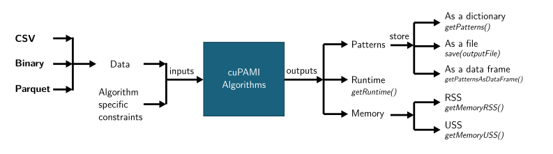
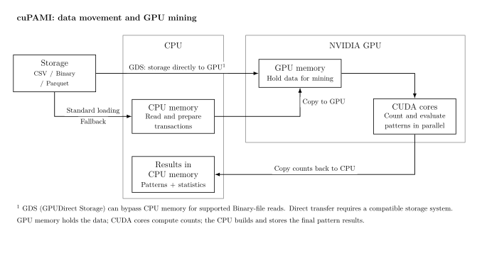

# cuPAMI

[PAMI](https://github.com/UdayLab/PAMI) is the main pattern-mining library.
cuPAMI is its CUDA version, focused on mining patterns using NVIDIA GPUs.
This repository is under development.

## Inputs and outputs



## GPU loading and mining



[Loading formats and GDS details](docs/transaction-formats.md#gpu-loading-and-mining)

## Quick start

```python
import cupami as cuPAMI

data = cuPAMI.TransactionalDatabase(
    transactions=10000,
    items=50,
    min_length=2,
    max_length=10,
).create()

miner = cuPAMI.cuApriori(data, minSup=0.01)
miner.mine()
patterns = miner.getPatterns()
```

This generates 10000 transactions and finds patterns appearing in at least
1% of them. Saving a dataset is optional.

Replace `cuApriori` with `cuEclat` or `cuFPGrowth` to use another algorithm.
See [quickstart.ipynb](quickstart.ipynb) for a runnable example of all three.
Mining requires CuPy and a CUDA GPU.

## Algorithms

| Data | Algorithms | Parameters |
|---|---|---|
| Transactional | `cuApriori`, `cuEclat`, `cuFPGrowth` | `minSup` |
| Temporal | `cuPFApriori`, `cuPFEclat`, `cuPFGrowth` | `minSup`, `maxPer` |

Transactional results contain each pattern's support count. Temporal results
contain `(support, periodicity)`.

## Temporal data

```python
import cupami as cuPAMI

data = cuPAMI.TemporalDatabase(
    transactions=10000,
    items=50,
    min_length=2,
    max_length=10,
).create()

miner = cuPAMI.cuPFEclat(data, minSup=0.02, maxPer=100)
miner.mine()
patterns = miner.getPatterns()
```

`maxPer=100` allows a maximum gap of 100 timestamp units, including the start
and end gaps. Temporal input rows have a timestamp followed by their items.

## Files are optional

Transactional miners also accept CSV, BIN, and Parquet files:

```python
miner = cuPAMI.cuEclat("transactions.bin", minSup=0.01)
miner.mine()
```

To save generated data, keep the generator:

```python
generator = cuPAMI.TransactionalDatabase(
    transactions=10000,
    items=50,
    min_length=2,
    max_length=10,
)
data = generator.create()
generator.save("transactions.csv")
generator.save("transactions.bin")
generator.save("transactions.parquet")
```

Parquet export requires PyArrow. Temporal files currently support timestamp-first
CSV/text. See [data formats and GPU loading](docs/transaction-formats.md)
for input details and optional GDS support.

## Convert a dataset

```python
cuPAMI.convertFile("transactions.csv", "transactions.bin")
cuPAMI.convertFile("transactions.csv", "transactions.parquet")
```

## Enable GPUDirect Storage (GDS)

For large Binary datasets on a compatible system, we recommend trying GDS
when file loading is a bottleneck. It can reduce CPU staging and transfer
overhead; benchmark total loading and mining time against standard loading.
GDS does not make the mining kernels faster or increase GPU memory capacity.
See NVIDIA's [GDS overview](https://docs.nvidia.com/gpudirect-storage/overview-guide/)
and [performance guidance](https://docs.nvidia.com/gpudirect-storage/best-practices-guide/).

1. **Prepare the system.** On Linux, install compatible NVIDIA drivers, CUDA,
   and the GDS/cuFile components for your GPU and filesystem using NVIDIA's
   [installation guide](https://docs.nvidia.com/gpudirect-storage/troubleshooting-guide/index.html).
   Install CuPy and [KvikIO](https://docs.nvidia.com/kvikio/latest/)
   versions compatible with your CUDA environment. Keep the dataset on a
   supported storage mount, such as a suitably configured NVMe filesystem;
   an NVMe drive alone does not guarantee GDS support.
2. **Check GDS support.** Run the platform checker from your CUDA installation
   (adjust the path if CUDA is installed elsewhere):

   ```bash
   /usr/local/cuda/gds/tools/gdscheck.py -p
   ```

   Check the actual dataset mount as well, following NVIDIA's installation
   guide. Platform support alone does not establish that a file uses direct I/O.
3. **Load a Binary dataset through GDS.** Convert an existing transactional
   dataset once, then use the resulting file:

   ```python
   import cupami as cuPAMI

   cuPAMI.convertFile("transactions.csv", "transactions.bin")
   miner = cuPAMI.cuApriori(
       "transactions.bin", minSup=0.01, use_gds=True
   )
   print(miner.getInputBackend())
   miner.mine()
   patterns = miner.getPatterns()
   ```

`use_gds=True` requires the cuFile path and raises an error if it is unavailable.
The default, `use_gds="auto"`, falls back to standard loading. To compare with
bulk CPU reads and GPU transfers, use `use_gds=False`. These options also apply
to `cuEclat` and `cuFPGrowth`. The current loader holds the Binary file and mining
structures in GPU memory; GDS is not an out-of-core mining mode.

A reported `backend="cufile"` identifies the API used, not proof of direct
storage-to-GPU transfer: cuFile may still use compatibility I/O. For strict
verification, use a separate cuFile configuration with
`properties.allow_compat_mode=false` and `use_gds=True`, as described in
[verification and fallback details](docs/transaction-formats.md#optional-gds-input).
This explicit GDS route supports local transactional Binary files; temporal
GDS input is not currently supported.

## References

### Algorithm sources

| Implementation | Reference |
|---|---|
| `cuApriori`, Apriori search in `cuPFApriori` | Agrawal and Srikant, VLDB 1994 [1] |
| `cuEclat`, vertical search in `cuPFEclat` | Zaki et al., KDD 1997; Zaki, TKDE 2000 [2, 3] |
| `cuFPGrowth`, FP-tree search in `cuPFGrowth` | Han, Pei and Yin, SIGMOD 2000 [4] |
| Periodicity definition and pruning | Kiran, Kitsuregawa and Reddy, JSS 2016 [5] |

These implementations adapt the referenced algorithms for CUDA. The temporal
miners add maximum-gap checks, including the start and end gaps.

1. Rakesh Agrawal and Ramakrishnan Srikant. **Fast Algorithms for Mining
   Association Rules.** VLDB, 1994, pp. 487–499, Section 2.1.
   [Paper](https://www.vldb.org/conf/1994/P487.PDF).
2. Mohammed J. Zaki, Srinivasan Parthasarathy, Mitsunori Ogihara and Wei Li.
   **New Algorithms for Fast Discovery of Association Rules.** KDD, 1997,
   pp. 283–286. [Paper](https://www.cs.rpi.edu/~zaki/PaperDir/KDD97.pdf).
3. Mohammed J. Zaki. **Scalable Algorithms for Association Mining.** IEEE TKDE,
   12(3), 2000, pp. 372–390. DOI: 10.1109/69.846291.
   [Paper](https://www.cs.rpi.edu/~zaki/PaperDir/TKDE00.pdf).
4. Jiawei Han, Jian Pei and Yiwen Yin. **Mining Frequent Patterns without
   Candidate Generation.** SIGMOD, 2000, pp. 1–12.
   DOI: 10.1145/342009.335372. Algorithms 1–2 and Lemma 3.2.
   [Paper](https://cse.hkust.edu.hk/~raywong/comp5331/References/MiningFrequentPatternsWithoutCandidateGeneration.pdf).
5. R. Uday Kiran, Masaru Kitsuregawa and P. Krishna Reddy.
   **Efficient Discovery of Periodic-Frequent Patterns in Very Large Databases.**
   Journal of Systems and Software, 112, 2016, pp. 110–121.
   Section 1 and Example 1.
   [Paper](https://www.tkl.iis.u-tokyo.ac.jp/new/uploads/publication_file/file/744/5-8-2015_final.pdf).

### Code and GPU I/O credits

- **CUDA bitsets and cuDF loading:** adapted from
  [udayRage/cuda_pami](https://github.com/udayRage/cuda_pami),
  `src/algorithms/frequent/fpminer-bitset.py`, revision
  `2ed352a92190bf45455f61925f76b2363b7a7590`, GPL-3.0.
  [Source](https://github.com/udayRage/cuda_pami/blob/2ed352a92190bf45455f61925f76b2363b7a7590/src/algorithms/frequent/fpminer-bitset.py).
- **GDS:** NVIDIA [GPUDirect Storage](https://docs.nvidia.com/gpudirect-storage/overview-guide/index.html)
  and [cuFile API](https://docs.nvidia.com/gpudirect-storage/api-reference-guide/index.html),
  accessed through RAPIDS [KvikIO](https://github.com/rapidsai/kvikio).
  See the [KvikIO API](https://docs.rapids.ai/api/kvikio/stable/api/)
  and [runtime settings](https://docs.rapids.ai/api/kvikio/stable/runtime_settings/).
- **BIN layout, converter, and temporal CUDA kernels:** implemented in this repository.
